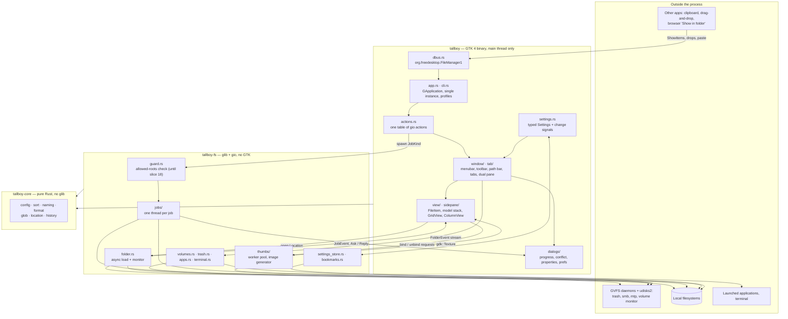

# DISCOVERY.md — `tallboy`

Discovery run 2026-10-13 against `.planning/PROMPT.md`. Decisions here are the owner's answers plus facts measured on the target workstation.

**Precedence:** `SCOPE.md` > `DISCOVERY.md` > `PROMPT.md`. Where this file is silent, the PROMPT stands unchanged, including its §3 "do not relitigate" list.

---

## 1. Facts about the target machine

Measured on 2026-10-13. Every decision below leans on at least one of these.

| Area | Finding |
|---|---|
| Session | Hyprland on Wayland; two 3840×2160 monitors at scale 1.5 (DP-1 160 Hz, DP-2 60 Hz); Xwayland installed |
| Upstream installed | `pcmanfm` 1.4.0 (git 2025-10-22, GTK 3) with `libfm` 1.4.1 — not the 1.3 the PROMPT names |
| Owner's PCManFM config | Near stock: maximised, `show_hidden=1`, `terminal=kitty`, `places_computer=0`. No `[desktop]` section; wallpaper is `swaybg`, bar is waybar |
| GTK | GTK 4.22.5 runtime. `gtk4-devel`, `glib2-devel`, `gdk-pixbuf2-devel` **not installed** |
| Rust | Fedora dnf Rust 1.98.1, clippy present, **`rustfmt` not installed** (a stale `~/.cargo/bin/rustfmt` fails to load) |
| Crates (crates.io) | `gtk4` 0.11.5 (needs Rust 1.92), `gio`/`glib` 0.22.10, `gdk-pixbuf` 0.22.0, `gio-unix` 0.22.8, `async-channel` 2.5.0, `regex` 1.13.1, `thiserror` 2.0.21, `log` 0.4.34, `tempfile` 3.27.0 |
| Filesystems | `/home` is btrfs; `/tmp` is tmpfs (RAM). Two unmounted internal disks: `sda1` (ext4, 1.8T) and `nvme0n1p3` (btrfs, 930G) |
| Trash | `gio trash` on a file in `/tmp` fails: "Moving to wastebasket on system internal mounts is not supported" |
| Real folder sizes | Largest measured is `/usr/bin` at 2,196 entries; `~` has 39. Subfolders of Documents and Downloads were not counted |
| GVFS backends | Present: sftp, ftp, dav, network, computer, trash, recent, admin. **Missing: smb, mtp** |
| Thumbnails | Only `gsf-office.thumbnailer` installed; `~/.cache/thumbnails` is empty. gdk-pixbuf 2.44 decodes through glycin (out of process). `bubblewrap` 0.12 installed |
| Privilege and secrets | `polkit-mate` agent running; `udisksd` running. **No secret service on the session bus** (KeePassXC installed but not providing one). SELinux enforcing |
| Desktop integration | `inode/directory` → `kitty-open.desktop`. Nothing owns `org.freedesktop.FileManager1` |
| Theme | GTK theme `NordArc-Theme` has `gtk-2.0` and `gtk-3.0` only; no `~/.config/gtk-4.0`. Icon theme Adwaita |
| Agent tooling | `codex`, `grim`, `wl-copy` present. `cage`, `weston`, `wtype`, `ydotool`, AT-SPI scripting **not installed** |
| Repo | `codedsleep/pcmanfm-port-rust`, private, branch `master`, pushed, identity `codedsleep` |

---

## 2. Decisions

### Purpose and scope

- **D1 — Daily driver.** `tallboy` replaces PCManFM on this workstation and will operate on the owner's real files. Data safety of the job engine outranks feature parity and speed.
- **D2 — Staged delivery.** v1 is PROMPT slices 0–12, 15 and 18. v1.x is slices 13 (Find Files) and 14 (templates, archivers, custom actions, applications folder).
- **D3 — Desktop manager deferred past v1.x.** Slices 16–17 are not built and nothing is scaffolded for them: no `desktop` cargo feature, no `gtk4-layer-shell`, no `core::desktop`, no `[desktop]` keys in `Config` (unknown keys are preserved on save anyway). `--desktop`, `--desktop-off`, `--desktop-pref`, `--one-screen`, `--set-wallpaper` and `--wallpaper-mode` are accepted, print `The desktop manager is not built in this version.` and exit non-zero for a first instance. The desktop is not a drag-and-drop target.
- **D4 — Deferred features stay visible but inert.** The §8.2 menu tree is reproduced exactly. Actions whose slice is deferred are registered and permanently disabled: Tools ▸ Find Files…, Go ▸ Applications. Create New lists only Folder and Empty File. The Applications row in Places, the Compress/Extract items, custom actions, and the archiver and template controls in Preferences are omitted. `Location::parse` returns a typed "not supported in this version" error for `search://` and `menu://`.
- **D5 — QA per goal, no deadline.** The owner runs that goal's `QA.md` section when the goal lands (§6).

### Scale, performance, integration

- **D6 — Budgets are calibrated, not assumed.** Slice 0 measures process start → first frame for an empty GTK 4 window (release build, warm, median of 10). The §13 first-frame budget becomes that baseline + 100 ms and is written into `SCOPE.md`. The 50,000-entry budgets remain hard gates even though real folders are far smaller.
- **D7 — The copy budget has two cases.** Cross-filesystem (tmpfs → btrfs, about 1 GiB of mixed files): within 10% of `cp -a`. Same-filesystem on btrfs: the copy should clone extents as `cp -a` does; verify in slice 6 and record the result. If GLib does not clone, log it as an open issue — do not hand-roll an ioctl.
- **D8 — Fixture and test directories live on btrfs.** `scripts/mkfixture.sh` builds `~/.cache/tallboy-fixture`, not `/tmp/tallboy-fixture`. `tallboy-fs` integration tests create their temp dirs under `CARGO_TARGET_TMPDIR`. `/tmp` is then a real second filesystem for the move-fallback test.
- **D9 — Hands-on QA matrix for volumes.** USB sticks and drives, the two internal disks (mount and unmount only — no write tests on them), SMB shares and an MTP phone. SFTP, FTP and WebDAV are built to spec but verified only by tests and review; `QA.md` marks them "not verified by hand".
- **D10 — Folder handler plus `FileManager1`.** The default-profile primary instance owns `org.freedesktop.FileManager1` and implements `ShowFolders`, `ShowItems` (navigate and select) and `ShowItemProperties`, using GIO's D-Bus. It never replaces an existing owner. Deviation from upstream; built in Goal E.
- **D11 — Reference is the installed 1.4.0.** The `pcmanfm` 1.4.0 / `libfm` 1.4.1 binaries on this machine settle any label, layout or edge case, side by side. Agents read upstream source at the matching versions. The importer targets the 1.4.1 config and prints, without importing, the keys §9 does not carry (`middle_click`, `force_startup_notify`, `date_iso_8601`, `smart_desktop_autodrop`).
- **D12 — X11 check is one XWayland run.** The main window is verified once with `GDK_BACKEND=x11` in Goal E. No native X11 session is set up.

### Security

- **D13 — Enforced job guard.** Every mutating entry point in `tallboy-fs` (all `JobKind`s, rename, create folder/file, bookmark writes excluded) calls one function, `fs::guard::check`, which rejects any source or destination outside the allowed roots unless `TALLBOY_UNLOCKED=1`. Allowed roots: the fixture directory, `CARGO_TARGET_TMPDIR`, and the system temp directory. Non-native URIs are rejected while locked. The guard has its own tests. Agents never set `TALLBOY_UNLOCKED`. The owner may set it after signing off Goal C. The guard is deleted in slice 18.
- **D14 — Agent and test runs are isolated.** They set `XDG_CONFIG_HOME`, `XDG_CACHE_HOME` and `XDG_DATA_HOME` to directories under `~/.cache/tallboy-agent/`. That keeps the real bookmarks file, trash and thumbnail cache untouched, and keeps the agent's trash on the same filesystem as the fixture so trashing still works. Agents use `--profile agent`.
- **D15 — Upstream launch prompts, plus a removable-media rule.** Prompts match PCManFM. Deviation: on filesystems whose execute bits are synthetic (vfat, exfat, ntfs, and any non-native location such as MTP or SMB) a `.desktop` launcher is never trusted, and an "executable" text file opens with its default application instead of offering Execute. The autorun dialog cannot remember a choice for `x-content/unix-software`.
- **D16 — Image thumbnails only in v1.** The built-in gdk-pixbuf generator ships; `.thumbnailer` support moves to v1.x and must run under `bwrap` when it arrives. Cache layout, validity checks and fail markers are unchanged, so the cache is still shared with other applications.
- **D17 — `admin://` is blocked.** `Location::parse` rejects the scheme with a clear message. Everything that produces a location — the location bar, command-line arguments, bookmarks, `FileManager1` — goes through `Location::parse`.
- **D18 — No shell.** Every `Exec` line and command line is parsed to an argument vector first, then file names are substituted per argument. Nothing is run through `sh -c`.

### Stack

- **D19 — Name stays `tallboy`**, app ID `io.github.codedsleep.Tallboy`.
- **D20 — System GTK 4 theme.** `tallboy` ships no colours and follows the system's theme and light/dark preference. It will not match the owner's NordArc PCManFM until a GTK 4 Nord theme is installed; that is accepted.
- **D21 — This workstation only.** `scripts/install.sh` builds release and installs to `~/.local`. No CI, no release pipeline, no portability testing. The `v4_14` feature floor stays as the PROMPT has it.
- **D22 — v1 dependency list.** `gtk4` 0.11.5 (`v4_14`), `glib`/`gio` 0.22.10, `gdk-pixbuf` 0.22.0, `gio-unix` 0.22.8 if `DesktopAppInfo` lives there (confirm on docs.rs at scaffold), `async-channel` 2.5.0, `thiserror` 2.0.21, `log` 0.4.34, dev-only `tempfile` 3.27.0. `regex` and `gtk4-layer-shell` are not v1 dependencies; they arrive with the slices that need them.
- **D23 — Crash log.** The release profile keeps `panic = "abort"`. A panic hook writes the message and location to `$XDG_STATE_HOME/tallboy/crash.log` first, because a keybind-launched process has no visible stderr.

### Development and operations

- **D24 — Split by crate.** Within each goal Codex writes `tallboy-core` and `tallboy-fs` with their headless tests, then Claude writes the `tallboy` GTK crate, `data/` and `QA.md`. PROMPT §7 is the API contract between them. Codex leaves `.planning/HANDOFF-<goal>.md` describing the API as built. If Claude is blocked by a gap in `fs` or `core`, Claude may patch it and must list the patch in the hand-off for Codex's review.
- **D25 — Agents check the UI headlessly.** `scripts/agent-run.sh` starts `tallboy` inside a headless `cage` session with the D14 environment and captures it with `grim`. Nothing appears on the owner's monitors. Because every command is a `gio` action (§7.7), agents drive the UI by activating actions over D-Bus rather than injecting input. Drag-and-drop, clipboard interop and volumes cannot be checked this way and belong to owner QA.
- **D26 — Review per goal, twice for Goal C.** Codex reviews each goal before owner QA. Goal C's job engine gets a second review focused on data loss — symlink handling, partial files, cancel, cross-filesystem move, the guard — before the owner may unlock.
- **D27 — Side-by-side cutover.** `install.sh` installs the binary, `.desktop` file and icon and changes no defaults. `install.sh --set-default` registers `inode/directory` and installs the `FileManager1` D-Bus service file. PCManFM stays installed as the reference.
- **D28 — Repo conventions.** Private repo, `master`, commit prefix `slice N:`, push at the end of each slice. `scripts/check.sh` is the only gate.

---

## 3. Recommended stack

| Layer | Choice | Why |
|---|---|---|
| Language | Rust stable 1.98, edition 2024 | Already installed; `gtk4` 0.11 needs 1.92 |
| Toolkit | GTK 4 via `gtk4` 0.11.5, feature `v4_14`, no libadwaita | PROMPT §3; the installed GTK 4.22 is well above the floor |
| File access | GIO/GVFS for every user-visible location | Trash, mounts and remote schemes come for free; same platform as upstream |
| Concurrency | GLib main loop, one `std::thread` per job, `async-channel` back to the main thread | PROMPT §3 and §7.5; no async runtime |
| Config | GKeyFile via `glib::KeyFile`, upstream key names | Lets the importer map keys one to one |
| Errors and logs | `thiserror` enums in `core`/`fs`; `log` bridged to GLib; crash log (D23) | Typed errors at the crate boundary; diagnosable when launched from a keybind |
| Desktop integration | `GApplication` single instance; `FileManager1` over GIO D-Bus | No extra dependency |
| Verification | `cargo test` headless for `core`/`fs`; headless `cage` + `grim` for the UI; owner QA per goal | Matches what can and cannot be automated here |
| Packaging | `scripts/install.sh` to `~/.local` | One machine (D21) |

---

## 4. Architecture



Rules that hold the shape: dependencies only point downward (enforced by `Cargo.toml`); the binary contains no file-operation logic; workers never call GTK; the main thread never blocks on a channel or on synchronous GIO.

---

## 5. Project structure for v1

PROMPT §6 with deferred modules removed and discovery additions marked `+`.

```
pcmanfm-port-rust/
├── Cargo.toml                    # workspace, pins from D22
├── README.md  COPYING
├── .planning/
│   ├── PROMPT.md  DISCOVERY.md  SCOPE.md  QA.md
│   └── HANDOFF-<goal>.md         # + Codex → Claude, one per goal (D24)
├── crates/
│   ├── tallboy-core/src/         # thiserror, log only
│   │   ├── lib.rs  config/  sort.rs  naming.rs  format.rs
│   │   └── glob.rs  location.rs  history.rs
│   │       (deferred: search.rs, actions.rs, exec.rs, desktop/)
│   ├── tallboy-fs/src/
│   │   ├── lib.rs  meta.rs  folder.rs  jobs/  thumbs/
│   │   ├── guard.rs              # + D13
│   │   ├── settings_store.rs  bookmarks.rs  volumes.rs
│   │   └── apps.rs  terminal.rs  trash.rs
│   │       (deferred: archiver.rs, templates.rs, appmenu.rs, search.rs)
│   └── tallboy/src/
│       ├── main.rs               # + panic hook (D23)
│       ├── app.rs  cli.rs  settings.rs  actions.rs
│       ├── dbus.rs               # + FileManager1 (D10)
│       ├── window/  tab/  view/  sidepane/  dialogs/
│       └── clipboard.rs  volumes.rs
│           (deferred: desktop/)
├── data/
│   ├── io.github.codedsleep.Tallboy.desktop
│   ├── org.freedesktop.FileManager1.service   # + installed by --set-default
│   ├── tallboy.svg  style.css  terminals.list  tallboy.1
│   └── (deferred: archivers.list, tallboy-desktop-pref.desktop)
└── scripts/
    ├── check.sh  mkfixture.sh  install.sh
    └── agent-run.sh              # + headless cage wrapper (D25)
```

---

## 6. Roadmap

Five goals. Each runs Codex (`core` + `fs`) → hand-off → Claude (GTK crate) → Codex review → owner QA.

| Goal | Slices | Codex builds | Claude builds | Owner can do at the end |
|---|---|---|---|---|
| **A** | 0, 1, 2 | Workspace, pins, `check.sh`, `mkfixture.sh`; all v1 `core` modules; `settings_store`, `meta`, `folder`; trace timings | Application, CLI, full menu bar and action table, `Settings`, `FileItem`, model stack, icon view, status bar, smoke mode, `agent-run.sh`; first-frame baseline (D6) | Browse any folder in icon view; edit the config by hand |
| **B** | 3, 4, 5 | `apps`, `terminal`, dir-settings | Toolbar, path bar, tabs, history; compact, thumbnail-size and list views; sort, filter, zoom, type-ahead; Open With, launch prompts with the D15 rule, Run a Command; CLI arguments, daemon mode, signals | Navigate and open files as in PCManFM |
| **C** | 6, 7 | `jobs/` complete with tests; `guard.rs` | Progress, conflict and error dialogs; trash, delete, rename, create, link, move-to, copy-to; clipboard; drag-and-drop | Copy, move and delete inside the fixture. After two reviews and QA, may unlock |
| **D** | 8, 9, 10 | `bookmarks`, `trash`, `volumes`; `Count` and `SetAttrs` jobs | Context menus, Places, Directory Tree, bookmark dialogs; mount UI, autorun, Connect to Server; Properties | Use USB, internal disks, SMB, MTP, trash and Properties |
| **E** | 11, 12, 15, 18 | `thumbs/` (images only); importer key mapping; `fs` performance pass | Thumbnail binding and cache; dual pane, fullscreen, help, About; Preferences; `FileManager1`; leak counters; man page, `.desktop` file, `install.sh`; X11 check; guard removal | Import PCManFM settings, install, run side by side, then `--set-default` |

Later, in order: **v1.x-a** slice 13 (Find Files, brings `regex`); **v1.x-b** slice 14 plus sandboxed external thumbnailers; **v2** slices 16–17 (desktop manager).

### Owner prerequisites

The runtime libraries are the ones PCManFM already uses (GLib/GIO, gdk-pixbuf, GVFS), plus the GTK 4 runtime, all installed. What is missing is build tooling: no `-devel` package of any kind is present.

| When | Command | Why |
|---|---|---|
| Before slice 0 | `sudo dnf install gtk4-devel rustfmt` | Headers and pkg-config files to compile (`gtk4-devel` should pull in the GLib and gdk-pixbuf headers); the fmt gate |
| During Goal A | `sudo dnf install cage` | Agents' headless UI checks (D25) |
| Before Goal D QA | `sudo dnf install gvfs-smb gvfs-mtp` | SMB shares and MTP phone; PCManFM needs the same two |
| Optional | `sudo dnf install gvfs-fuse` | Lets non-GIO applications open files from remote locations |

After the first install, slice 0 confirms `pkg-config --modversion gtk4 glib-2.0 gio-2.0 gdk-pixbuf-2.0` all resolve.

---

## 7. Security checklist

Audited 2026-10-13. Ticks mean evidence reviewed; remaining behavior findings and owner-only checks are stated explicitly. Crate references below are relative to `crates/tallboy-fs`, `crates/tallboy-core` or `crates/tallboy` as indicated; test paths without a crate prefix are in `crates/tallboy-fs/tests`.
**Destructive operations**
- [x] `fs::guard::check` is called by every mutating entry point; a test enumerates them and fails if one is missed (Goal C). **Evidence (Phase 10):** `fs/tests/guard.rs::every_mutating_entry_point_uses_guard`; job preflight and single-item APIs independently check the guard.
- [x] Recursive delete, attribute change and count never follow symlinks; a symlink to a directory is removed as a link (Goal C, D). **Evidence (Phase 10):** `jobs.rs::links_and_recursive_delete_never_follow_symlinks`, `recursive_attrs_skip_symlink_targets_and_non_utf8_self_copy`, `setattrs_count_and_single_item_operations`; permission-repair limitation is HANDOFF-C decision 2.
- [x] Copy uses `NOFOLLOW_SYMLINKS`; a symlink loop in the fixture terminates (Goal C). **Evidence (Phase 10):** `jobs.rs::links_and_recursive_delete_never_follow_symlinks`; `fs/src/jobs/transfer.rs` uses NOFOLLOW_SYMLINKS.
- [x] A cancelled or failed copy leaves no partial destination file (Goal C). **Evidence (Phase 10):** `data_loss.rs::cancel_mid_file_preserves_existing_destination`, `destination_disappears_mid_job`; crash/kill staging residue is deviation 17, separate from handled cancellation.
- [x] Copying or moving a directory into itself, or onto itself, is rejected before any write (Goal C). **Evidence (Phase 10):** `jobs.rs::copy_merge_self_copy_and_into_self_preflight`, `recursive_attrs_skip_symlink_targets_and_non_utf8_self_copy`; engine preflight runs before preparation/writes.
- [x] Move falls back to copy-then-delete only after the copy of that item fully succeeded (Goal C). **Evidence (Phase 10):** `data_loss.rs::real_cross_filesystem_move_and_injected_copy_failure`; source retained after failure. Child error recovery is HANDOFF-C decision 1.
- [x] Delete inside `trash://` and Shift+Delete always confirm when `confirm_del=1`; the dialog names the file or the count (Goal C). **Evidence (Phase 10):** `tallboy/src/window/fileops.rs::delete`, `scripts/agent/checks/fileops.sh`; selected URIs and names captured before confirmation.
- [x] *Proposed deviation:* a recursive delete that meets a mount point inside the tree stops and asks rather than descending (Goal C; see O-5). **Evidence (Phase 10):** `fs/src/jobs/operations.rs::recursive_delete_mount_boundary` tests policy and Question::MountBoundary dispatch; real mounted media remains owner QA.

**Execution**
- [x] No `sh -c` anywhere; `Exec` parsed to argv before substitution (D18). A fixture file named `; rm -rf ~` opens harmlessly (Goal B). **Evidence (Phase 10):** `fs/tests/apps.rs::terminal_argv_has_no_shell_interpolation`, `apps_fixture_subprocess`, `isolated_app_launches`; `checks/opening.sh`. Production launcher/terminal argv reviewed; test stand-in scripts use shells deliberately.
- [x] Launcher trust requires an executable bit on a filesystem with real permissions, or a path under an XDG applications directory (D15) (Goal B). **Evidence (Phase 10):** `core/src/open.rs::decision_table`, `tallboy/src/open.rs::execution_trust_queries_the_target_filesystem_and_refuses_unknown_trust`; actual target filesystem queried at activation, including symlinks. Real synthetic mount remains owner QA.
- [x] Executable-text prompt suppressed on synthetic-permission filesystems (D15) (Goal B). **Evidence (Phase 10):** `core/src/open.rs::decision_table` and activation filesystem regression above.
- [x] `quick_exec` defaults to 0 and is never set by the importer without printing it (Goal E). **Evidence (Phase 10):** `core/src/config` default and codec tests; `fs/tests/import.rs::owners_config_copies_and_explicit_quick_exec_advisory` verifies the printed advisory.
- [x] Autorun never launches without a dialog on first sight of a content type; no remembered choice for `x-content/unix-software` (Goal D). **Evidence (Phase 10):** `fs/tests/volumes.rs::filters_automount_and_autorun`; `tallboy/src/volumes.rs` and `dialogs/autorun.rs` reviewed; first-time dialog always presented, remembered software execution prohibited. Real insertion remains owner QA.

**Locations and input**
- [x] `admin://` rejected by `Location::parse` from every entry point (D17) (Goal A). **Evidence (Phase 10):** `core/src/location.rs` parser tests; CLI, tab navigation, bookmarks, Connect and FileManager1 enter through Location::parse; no alternate privileged backend.
- [x] File names are never assumed UTF-8; the newline-in-name fixture survives clipboard, drag-and-drop and Copy Path(s) without splitting into two entries (Goal C). **Evidence (Phase 10):** `core/src/invocation.rs::raw_process_filenames`, `core/src/transfer.rs::newline_roundtrip`, `data_loss.rs::newline_in_name`; clipboard/dnd scripts exercise newline items as one URI. Cross-application transfer remains owner QA.
- [x] `FileManager1` arguments are parsed as locations, never executed or opened as files (Goal E). **Evidence (Phase 10):** `fs/src/filemanager1.rs` parser/ownership tests and `checks/filemanager1.sh` private-bus sessions; UI handler navigates folders/selects items.
- [x] Bookmarks and config are written to a temp file and renamed; a symlinked config file is replaced, not followed into (Goal A, D). **Evidence (Phase 10):** `fs/tests/settings.rs::corrupt_and_symlink`, `bookmarks.rs::bookmarks_roundtrip_and_edits`; `fs/src/atomic.rs` uses same-directory temporary file and rename.

**Thumbnails**
- [x] Only the built-in image generator runs in v1 (D16) (Goal E). **Evidence (Phase 10):** `fs/src/thumbs/pool.rs::generate` uses gdk-pixbuf only, no thumbnailer registry or process spawning.
- [x] Thumbnails are written 0600 via temp file and rename; files inside the cache are never thumbnailed (Goal E). **Evidence (Phase 10):** `fs/tests/thumbs.rs::cache_vector_sizes_chunks_validity_fail_and_skip`; `fs/src/thumbs/cache.rs` atomic save and cache-path exclusion.
- [x] `thumbnail_max` and `thumbnail_local` are honoured before any decode starts (Goal E). **Evidence (Phase 10):** `fs/src/thumbs/pool.rs::generate` calls skip before cache read/decode; `cache_vector_sizes_chunks_validity_fail_and_skip` covers limits/local policy.

**Credentials and privilege**
- [x] Passwords only ever pass through `gtk::MountOperation`; none are logged, including at trace level (Goal D). **Evidence (Phase 10):** `tallboy/src/dialogs/connect.rs` routes to `tallboy/src/volumes.rs::operation`, which uses gtk::MountOperation; no password entry/storage/logging in application. `core/src/location.rs::embedded_passwords_never_enter_stored_or_logged_locations` rejects credentials in URIs, including escaped userinfo. Live secret-service behavior remains owner QA.
- [x] Unmount is never forced; a busy volume reports the error (Goal D). **Evidence (Phase 10):** `fs/src/volumes/operations.rs` passes MountUnmountFlags::NONE; `fs/tests/volumes.rs::mount_locations_and_busy_error` tests busy-error presentation mapping.
- [x] `QA.md` records that "remember forever" is unavailable without a secret service (Goal D). **Evidence (Phase 10):** QA Phase 8 explicitly records absent secret service and unavailable remember-forever; owner checkpoint 4 tests real password prompt.

**Process**
- [x] `#![deny(unsafe_code)]` in `core` and `fs`; any `unsafe` in the binary is isolated and listed in `SCOPE.md`. **Evidence (Phase 10):** Both crate roots deny unsafe; production binary has no unsafe blocks. `scripts/agent/vinput.c` is separate test tooling, not application code.
- [x] Agents and tests run with the D14 environment and `--profile agent`; `check.sh` asserts the XDG variables are set before the smoke run. **Evidence (Phase 10):** `scripts/agent-run.sh` isolates XDG config/cache/data/state, bus and displays, unsets unlock; `tallboy/src/cli.rs::check_smoke_isolation` checks XDG values/profile before smoke; test fixtures use private dirs/buses.
- [x] `COPYING` (GPL-2.0) and upstream credit present before the first code commit. **Evidence (Phase 10):** `COPYING`, README and `tallboy/src/dialogs/help.rs` About credit inspected; licence was present at initial scaffold.
---

## 8. Risks

| # | Risk | Likelihood | Impact | Response |
|---|---|---|---|---|
| R1 | A job-engine defect destroys real files | Medium | Severe | Guard (D13), isolated runs (D14), two reviews of Goal C (D26), no unlock before owner QA |
| R2 | GTK 4 list views fight drag-and-drop: pressing a selected item to drag collapses a multi-selection, and rubber-band competes with the drag gesture | High | High | One-day spike at the end of Goal A on the fixture; settle the gesture design before Goal C. Fallback is a capture-phase click gesture that defers selection change to release |
| R3 | Application accelerators (`Delete`, `Ctrl+C`, `Backspace`) fire while a text entry has focus | High | High | PROMPT §8.8 already marks this critical. Decide the mechanism in slice 3 — disable file actions while an editable has focus, or scope shortcuts to the view — and cover it in `agent-run.sh` |
| R4 | Horizontal `GridView` does not behave like upstream's compact view (column fill, keyboard order, horizontal scrolling) | Medium | Medium | Same Goal A spike. Fallback: record a deviation and use a vertical multi-column list |
| R5 | First-frame budget unreachable on GTK 4 at 4K × 1.5 | Medium | Low | Calibrated in slice 0 (D6) |
| R6 | Memory budget (15 MB per 10,000 files) missed: one GObject plus about fifteen strings per item | Medium | Medium | Measure in slice 2 with `fixture/big`; share icon and content-type strings; store collation keys as bytes |
| R7 | Hand-off friction from the crate split: `fs` API does not fit what the UI needs | Medium | Medium | §7 as contract, hand-off document per goal, Claude may patch with disclosure (D24) |
| R8 | Agents cannot verify drag-and-drop, clipboard interop or volumes | Certain | Medium | Owner QA per goal (D5); `QA.md` states for each item whether it was checked by test, by screenshot or by hand |
| R9 | `cage` headless capture does not work with `grim` | Low | Medium | Verify in slice 0. Fallback: a Hyprland headless output in the live session (O-3) |
| R10 | gtk-rs names in the PROMPT differ from 0.11.5 | High | Low | PROMPT §5 rule: docs.rs wins; record renames in `SCOPE.md` |
| R11 | Host GVFS gaps cause confusing failures: no trash on tmpfs, no secret service, SELinux denials on metadata copy | Medium | Low | Degrade with a clear message; list each in `QA.md`; never treat a metadata-copy failure as a failed copy |
| R12 | Wayland clipboard contents vanish when the last window closes, losing a pending cut or copy | Medium | Low | Same as other GTK 4 apps without a clipboard manager; note in README |
| R13 | A panic aborts the process mid-copy | Low | High | No `unwrap` outside tests (PROMPT §10), crash log (D23), partial-file cleanup is per file so at most one file is affected |
| R14 | Late goals get less care than early ones | Medium | Medium | Staged v1 (D2); Goal E is deliberately the smallest in new behaviour |

---

## 9. Open points

- **O-1 — Who creates the Cargo workspace.** Assumed Codex, as the first act of Goal A. The owner's standing "never scaffold a project" rule is read as applying to the pre-scaffolded web stack; this repo contains only `.planning/`.
- **O-2 — Who performs Goal C's second review.** Codex wrote the engine, so the data-loss review is assigned to Claude for an independent read. Swap if the owner wants both reviews from Codex.
- **O-3 — Headless capture.** Confirm `cage` + `grim` in slice 0 (R9).
- **O-4 — btrfs cloning through GIO.** Confirm in slice 6 (D7).
- **O-5 — Mount points inside a recursive delete.** Proposed as a safety deviation in §7; needs the owner's yes before Goal C.
