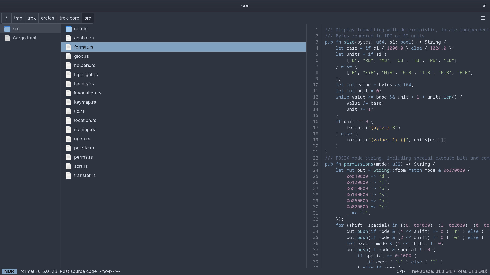

# trek

**Elevator pitch:** A graphical file manager for Linux, in Rust and GTK 4, driven from the keyboard with vim motions — parent folder, files and preview side by side, `h` `j` `k` `l` to move, `y` `x` `p` to yank, cut and paste, `z` to fuzzy-find — while the mouse, drag and drop, menus, trash can, volumes and remote places all still work.



## Features

- **Vim motions.** 117 bindings — `h` `j` `k` `l`, `gg` `G`, `Ctrl+U` `Ctrl+D`, `v` for visual mode, `y` `x` `p` to yank, cut and paste, `/` `n` `N` to find, and `g`, `m`, `c` and `,` to start a sequence — each with a description; `~` or `F1` lists them, and a started sequence lists its continuations at the bottom of the window.
- **Three columns.** Parent folder, files and a preview that lists a folder, shows the start of a text file, draws an image, and gives anything else a card with its type, size, date and permissions.
- **Code in the preview.** Text files are shown with line numbers and syntax highlighting, as bat shows them — bat's own grammars (Rust, TypeScript, TOML, Dockerfile, shell scripts by their `#!` line, and the rest) in the Nord theme, or a light theme on a light background.
- **Fuzzy finder.** `z` lists everything below the folder and matches as you type with fzf's query syntax, on all cores, honouring `.gitignore`. No fzf needed.
- **Fast folders.** A folder is listed on a thread of its own, read once, and handed between columns as you move; a tab keeps the last dozen folders it showed, still watched for changes.
- **Drives and media.** A USB stick is mounted when you plug it in, as in PCManFM, and asked about with the same "Removable medium is inserted" dialog. Its name appears as a button in the toolbar, lit until you look; `g m` lists every drive with its mount point — `Enter` opens one, `e` ejects it — and the status line says when something is connected, mounted, unmounted or safe to unplug.
- **Text files in your editor.** `$VISUAL`, `$EDITOR` or nvim, in a terminal; default applications and Open With for the rest.
- **Everything PCManFM does.** Tabs, dual pane, a side pane with places or a directory tree, five views, copy/move/trash with a progress window and conflict questions, volumes, Connect to Server through GVFS, Properties, Preferences, thumbnails.
- **Your GTK theme.** Dark, in the colours of the desktop's theme — including GTK 3-only themes, whose palette is carried over onto GTK 4's stylesheet.
- **Desktop integration.** One instance per profile, daemon mode, the `org.freedesktop.FileManager1` service ("Show in folder"), and an importer for PCManFM's settings.

## Install

```sh
curl -fsSL https://raw.githubusercontent.com/codedsleep/trek/master/install.sh | sh
```

Downloads the latest release, verifies its checksum and installs the binary, a launcher, the icon and the man page under `~/.local`. No folder defaults change. The binary uses the system's GTK 4 (4.14 or later) and glibc (2.39 or later, as on Fedora 40, Ubuntu 24.04, Debian 13 and Arch) — x86_64 and aarch64.

```sh
... | sh -s -- --set-default        # also open folders with trek and answer "Show in folder"
... | sh -s -- --prefix /usr/local  # install somewhere else
... | sh -s -- --version v1.2.1     # pin a release
... | sh -s -- --uninstall          # remove it again
```

Prebuilt archives and `SHA256SUMS` are on the [releases page](https://github.com/codedsleep/trek/releases).

At run time it wants `gvfs` with the backends you use (`gvfs-smb`, `gvfs-mtp`, `gvfs-fuse` and so on), `udisks2`, `shared-mime-info` and an icon theme.

### From source

Requires Rust 1.92+ and GTK 4.14+ (developed against 4.22). Fedora packages:

```sh
sudo dnf install gtk4-devel glib2-devel gdk-pixbuf2-devel gcc pkgconf-pkg-config \
    rust cargo rustfmt clippy
```

```sh
git clone https://github.com/codedsleep/trek && cd trek
scripts/install.sh                   # build, then install into ~/.local, beside PCManFM
scripts/install.sh --set-default     # also open folders with trek
scripts/install.sh --uninstall
```

`--set-default` makes trek the handler for folders, installs the D-Bus service file that lets other programs ask it to show a file, and prints the command that undoes the first of those.

## Quickstart

`trek` opens the current directory; `trek ~/Downloads` opens a folder, as a tab in the window last used. Press `~` or `F1` for the list of keys, with a field that narrows it as you type. `man trek` lists the command-line options.

### Default keybindings

| Key                                                    | Action                                                               |
| ------------------------------------------------------ | -------------------------------------------------------------------- |
| `j` `k`, `gg` `G`, `Ctrl+U` `Ctrl+D` `Ctrl+B` `Ctrl+F` | move the cursor; single steps wrap around                            |
| `h` `l`, `H` `L`                                       | parent folder, enter; back, forward                                  |
| `Space`, `v` `V`, `Ctrl+A` `Ctrl+R`, `Esc`             | toggle, visual mode, select all, invert, clear                       |
| `o` `Enter`, `O` `Shift+Enter`                         | open; open with                                                      |
| `y` `x` `p` `P`, `Y` `X`, `-`                          | yank, cut, paste, paste over; unyank; link                           |
| `d` `D`, `a`, `r`                                      | trash, delete; create (`/` at the end: folder; `a/b/` nests); rename |
| `/` `?` `n` `N`, `f`                                   | find, next, previous; filter                                         |
| `z`                                                    | fuzzy finder over everything below the folder                        |
| `.`, `m…`, `,…`                                        | hidden files; linemode; sort                                         |
| `c…`                                                   | copy path, URL, folder path, name                                    |
| `g…`                                                   | home, `~/.config`, Downloads, trash can, location entry, follow link |
| `tt` `tr`, `1`–`9`, `[` `]`, `{` `}`                   | new tab, name it; switch; step; swap                                 |
| `;` `:`                                                | shell command, here or in a terminal; the files are `"$@"`           |
| `J` `K`, `Tab`, `w`, `q` `Ctrl+C`                      | scroll the preview, properties, running jobs, close                  |

The cursor and the selection are different things: moving the cursor selects nothing, and a command acts on the selected files, or on the file under the cursor when none is selected. Yanked files are on the clipboard, where other programs can paste them, and files copied in other programs can be pasted with `p`.

Keys are commands only while the files have the keyboard. In the input line, the location entry or a dialog, every key is text; the input line has vim's insert-mode editing keys (`Ctrl+A` `Ctrl+E` `Ctrl+U` `Ctrl+K` `Ctrl+W` and friends). A question is answered with `y` or `Enter`, and `n` or `Esc`.

### The fuzzy finder

`z` lists everything below the folder shown and narrows the list as you type: the letters of the query have to occur in a path in that order, not side by side, and the best matches come first. `wvim` finds `src/window/vim.rs`. `Enter` enters a folder, or goes to a file's folder and puts the cursor on the file; `Esc` closes the list.

- The query is fzf's: words separated by spaces must all match, in any order; `'word` matches exactly, `^word` at the start, `word$` at the end, `!word` leaves out what matches. Without a capital letter it ignores case.
- `Down` `Up`, `Ctrl+N` `Ctrl+P`, `Ctrl+J` `Ctrl+K`, `Tab` `Shift+Tab` and the page keys move through the list; the wheel does too, and a click goes to a row.
- Like fd it leaves out what `.gitignore` excludes inside a repository, and what `.ignore` and your global Git ignore file exclude anywhere; it never looks inside `.git`. Hidden files are searched when they are shown (`.`). Symbolic links are listed, not followed.
- The folder is listed in the background and matched on all cores, so a home folder with several hundred thousand files can be searched while it is still being read. A million files is the limit; past it the count says so.
- Only folders on this computer can be searched, not the trash can or a network location.

The list is the window's own; fzf does not have to be installed.

### Notes on the keys

- Eight bindings answer "not available" in the status line and do nothing else: `s` and `S` (search with fd and ripgrep), `Ctrl+S`, `Z` (zoxide), `A` (bulk create), `_` (relative link), `Ctrl+-` (hard link) and `,r` (random order).
- `r` renames one file; with several selected it says so instead of opening an editor.
- `,a` and `,n` are the same order: names are always compared the natural way.
- `P` replaces existing files without asking, except that a folder is never replaced by a file: that still asks.
- `Tab` opens Properties, `w` brings up the progress windows of running jobs, `Ctrl+Z` minimises the window.
- The input line edits like any text entry; it has no normal mode.
- `a` creates one file or one folder, not a path of several.
- In the icon, thumbnail and compact views `j` and `k` step through the files in order; `h` and `l` still leave and enter.

### Window keys

Beside the vim motions, a program with a window is expected to have these: `Backspace` (parent), `Delete` and `Shift+Delete`, `F2`, `F5`, `Alt+Enter`, `Ctrl+L`, `Alt+Left` `Alt+Right` `Alt+Up` `Alt+Home`, `Ctrl+T` `Ctrl+W` `Ctrl+N` `Ctrl+Q`, `Ctrl+Tab`, `Ctrl+1`…`Ctrl+5` for the five views, `Ctrl+=` `Alt+-` `Ctrl+0` to zoom, `F3` `F6` for dual-pane mode, `F7` `F8` for the parent and preview columns, `F9` for the side pane, `F10` for the menu and `F11` for full screen.

PCManFM's `Ctrl+C`, `Ctrl+X` and `Ctrl+V` are gone: `Ctrl+C` closes the tab, and half a set of clipboard keys would be a trap. So are `Ctrl+A` as an accelerator (it selects all), `Ctrl+R`, `Ctrl+D`, `Ctrl+B`, `Ctrl+H`, `Ctrl+E`, `Ctrl+I` and `Alt+1`…`Alt+0`, and typing a name to jump to it: that is `/` now.

## The window

- **Three columns**, one part parent folder, four parts files, three parts preview. Only local files are previewed. `F7` and `F8` hide a column; in dual-pane mode both are hidden.
- **A folder is read once.** Entering a folder moves the listing the preview was showing into the files column, and the one the files column was showing into the parent column; `h` moves them back. A tab also keeps the last dozen folders it has shown, each still watched for changes, so going back to one reads nothing. `F5` (Reload Folder) reads the folder from disk whatever is kept. A folder is listed by its names, on a thread of its own; files whose name does not say what they are (a script without an extension) are read just afterwards and their icons follow.
- **The line view**, one file per row with the linemode at the right, is the default. The icon, compact, thumbnail and detailed-list views are still there (`Ctrl+2`…`Ctrl+5`); they draw the cursor as a frame.
- **The status line** shows the mode (`NOR`, `SEL`, `UNS`), the file under the cursor, the keys of a started sequence, the filter, how many files are selected and yanked, and the cursor's position.
- **No menu bar** unless you ask for one (View ▸ Show Menu Bar): the button at the right of the path holds the same menus, and `F10` opens it. The side pane starts hidden (`F9`).

## Config

Settings are made in Preferences (Edit ▸ Preferences) and apply at once. They are saved in `~/.config/trek/PROFILE/trek.conf`, beside `dir-settings.conf` for the views remembered per folder; the profile is `default` unless `--profile NAME` names another, and each profile runs as its own instance. The keys keep PCManFM's names.

### Coming from PCManFM

```sh
trek --import-pcmanfm
```

reads `~/.config/pcmanfm/default/pcmanfm.conf` and `~/.config/libfm/libfm.conf`, takes over every setting trek also has, and prints what it imported and what it left. It changes neither file and is never run for you.

### Theme

It is dark, in the colours of the desktop's GTK theme. A theme with a GTK 4 part is loaded by GTK, in its dark variant when it has one. A theme written for GTK 3 only, which is what PCManFM draws with, cannot be loaded by GTK 4: trek then takes the colours the theme names (`@define-color theme_bg_color` and the rest) and recolours GTK 4's own stylesheet with them. The palette is the theme's; the shapes and spacing of buttons, tabs and menus stay GTK 4's. The theme is read at start-up, so a change of theme shows after a restart.

```sh
TREK_GTK_THEME=NordArc-Theme trek   # try another theme for one run
GTK_THEME=Adwaita:light trek        # GTK's own light look for one run
```

### Environment

| Variable           | Effect                                                        |
| ------------------ | ------------------------------------------------------------- |
| `TREK_ALLOW_ROOTS` | [confine](#confining-changes) changes to the folders it lists |
| `TREK_GTK_THEME`   | the GTK theme to take colours from, in place of the desktop's |
| `TREK_TRACE=1`     | print timings, memory and stall probes to the terminal        |

A crash is written to `~/.local/state/trek/crash.log`.

## Safety

Two things to know about how trek changes files:

- **Recursive operations follow paths, not open folders.** While trek is deleting or copying a folder tree, another program that swaps a folder in that tree for a symbolic link can redirect the rest of the operation. PCManFM and most file managers share this. Do not run a recursive delete in a folder that another user or an untrusted program can write to.
- **A crash or kill in the middle of a copy** can leave a hidden file named `.trek-copy-…` beside the destination. It is safe to delete.

### Confining changes

To try trek where a slip would cost nothing, start it with `TREK_ALLOW_ROOTS`. While it is set, every operation that changes files — copy, move, link, trash, delete, rename, create, changing permissions — is refused unless all of its sources and its destination lie inside the folders it names, the test fixture `~/.cache/trek-fixture` or the temporary directory; trek says why when it refuses. Several folders are separated by semicolons, and a remote folder is given as a URI:

```sh
TREK_ALLOW_ROOTS=/run/media/$USER/STICK trek
TREK_ALLOW_ROOTS='/mnt/scratch;smb://nas/share/tmp' trek
```

While confined, the trash can is only usable when trek's data folder is itself inside an allowed folder. `scripts/dev-run.sh` and the headless checks always set it, so a development session cannot change anything outside its own folders.

## Hyprland and Wayland notes

- The application id is `io.github.codedsleep.Trek` (with `--profile NAME`: `io.github.codedsleep.Trek.p_NAME`), for window rules. Dialogs are transient windows and float without a rule. A key binding: `bind = $mainMod, E, exec, trek`.
- An application started from trek is handed an activation token, so its window takes the focus.
- **The clipboard is the compositor's.** Files you cut or copy stay on the clipboard only while a trek window exists. Close the last window before pasting and the cut or copy is gone, unless a clipboard manager is running. This is true of every GTK 4 program.
- **Modifier keys during a drag.** On Wayland the program you drop on decides between copy, move and link. trek reads Ctrl and Shift itself, so they work for drags inside trek and for drops onto trek while its window has the keyboard; other programs may ignore them.
- Mounting an internal disk needs a polkit agent running in the session. "Remember forever" for a network password needs a secret service (GNOME Keyring, KeePassXC's, or similar) on the session bus; without one a password is kept for the session at most.
- Fractional scaling is handled: thumbnails are requested at the size the monitor's scale needs.
- There is no desktop manager: trek does not draw a wallpaper or desktop icons, and `--desktop` says so.
- X11 works through XWayland with `GDK_BACKEND=x11`, but Wayland is what it is used and tested on.

## Differences from PCManFM

Keys and layout are trek's own, as described above. Everything else that is not listed here is meant to behave as PCManFM 1.4.0 does.

1. Find Files, templates, archivers, custom actions and the applications folder are absent; their menu items are disabled or omitted
2. No desktop manager; its command-line options report that it is not built
3. `--role` accepted with no effect
4. `admin://` rejected
5. Launchers and scripts on filesystems with synthetic execute bits are never trusted or offered for execution
6. Autorun choice cannot be remembered for `x-content/unix-software`
7. No external thumbnailers
8. Owns `org.freedesktop.FileManager1`
9. Recursive delete stops and asks at a mount point
10. Follows the desktop's GTK theme: a theme with a GTK 4 part as it is, a GTK 3 theme by its colours only, on GTK 4's own widget shapes
11. Bookmarks ▸ Edit Bookmarks… exists; PCManFM 1.4.0 edits bookmarks only from the side pane
12. Compact view columns are all the same width and long names are ellipsised; upstream fits each column to its longest name. GTK 4's `GridView` has uniform cells
13. The selection highlight covers the whole grid cell, as GTK 4 themes draw it, not only the icon and name
14. A press on the padding around an item selects it on release, and a drag from there starts a rubber band; upstream deselects and rubber-bands from the gaps only
15. During a drag, Ctrl, Shift and Ctrl+Shift are read from the keyboard by the destination. For a drag that starts in another program they are only seen while trek's window has the keyboard, and a link can only be made by trek as the destination. Wayland has no link action and sources do not narrow their offer
16. Preparation errors stop the whole job; an execution error on one child ends that top-level folder’s copy, move, delete or attribute change. Skip abandons its remaining children; Retry repeats completed entries and conflicts. Upstream asks per file
17. A kill or crash in mid-copy can leave a hidden `.trek-copy-*` file beside the destination; upstream leaves the partial destination file instead
18. A folder dropped on the empty part of Places becomes a bookmark. Dropping exactly _between_ two bookmarks is not told apart from dropping _on_ one, which puts the files into that folder; files cannot be dropped on the Trash Can row
19. The directory tree shows a hidden folder that lies on the way to the current folder even when hidden files are off, so the current folder can always be seen in it
20. Owner and group names in Properties are looked up in `/etc/passwd` and `/etc/group`; an account known only to a directory service must be given as a number
21. When a volume is unmounted and `close_on_unmount` is on, a window's last tab goes Home instead of closing the window
22. Preferences has no controls for templates, archivers, the Applications place or the desktop, which v1 leaves out; icon sizes are chosen from a fixed list of sizes
23. `ShowItems` of `org.freedesktop.FileManager1` selects the first item asked for in each folder, not all of them
24. Closing the last tab of one of two panes leaves dual-pane mode and keeps the other pane's tabs
25. Passwords embedded in a location’s userinfo are rejected; credentials must be entered through the mount prompt
26. Recursive permission changes prepare the tree and visit children before parents; an inaccessible subtree cannot be repaired by granting access recursively
27. A listing error after an initial batch leaves the partial view in Loading; partial-result error presentation awaits an owner decision
28. Text files open in the editor (`$VISUAL`, then `$EDITOR`, then `nvim`) in the terminal, whatever application is set for their type; that includes executable scripts, which are no longer offered for execution unless `quick_exec=1`. Pictures written in XML (SVG) keep their applications. An application with `Terminal=true` is started in trek's terminal, not one from GIO's list
29. Media are automounted whenever GIO's volume monitor marks them for automounting, not only when the drive reports itself removable, so disk images you attach count too. A medium with no recognised content still gets the autorun dialog, as "Removable Disk" with only "Open in File Manager" and nothing to remember

## Development

```sh
cargo build --release -p trek   # the binary is target/release/trek
scripts/check.sh                # format, lints, tests, a start-up smoke test
scripts/mkfixture.sh            # test folders under ~/.cache/trek-fixture
scripts/dev-run.sh              # trek on the fixture, with its own settings
scripts/agent/checks/run-all.sh # every UI check, driven by key presses in a headless session
```

`dev-run.sh` uses its own D-Bus session and its own configuration, cache and data folders under `~/.cache/trek-dev`, so its bookmarks, trash can and default applications are not yours. What it starts — the terminal, the editor, applications — runs with your own settings: the script hands trek your folders and session bus as `TREK_HOST_*`, and trek gives them back to every program it starts.

| Crate              | What it is                                                                                                                                             |
| ------------------ | ------------------------------------------------------------------------------------------------------------------------------------------------------ |
| `crates/trek-core` | Pure logic: locations, sorting, naming, the settings model, command-line parsing. No I/O.                                                              |
| `crates/trek-fs`   | Everything that touches files through GIO: folder listing and monitoring, the job engine and its guard, trash, volumes, thumbnails, bookmarks. No GTK. |
| `crates/trek`      | The GTK 4 application.                                                                                                                                 |

Releases are built by GitHub Actions when a `v*` tag is pushed.

## Acknowledgements

- [PCManFM](https://github.com/lxde/pcmanfm) and [libfm](https://github.com/lxde/libfm) by Hong Jen Yee (PCMan) and Andriy Grytsenko (LStranger) — trek began as a port of PCManFM 1.4.0 with libfm 1.4.1, and everything that is not keys or layout still behaves as they do.
- [fzf](https://github.com/junegunn/fzf) — the fuzzy finder's query syntax and keys.
- [nucleo](https://crates.io/crates/nucleo) — fuzzy matching.
- [ignore](https://crates.io/crates/ignore) — walking folders the way fd and ripgrep do.
- [gtk-rs](https://gtk-rs.org) — the Rust bindings for GTK 4, GLib and GIO.

## License

GPL-2.0-or-later, as PCManFM and libfm are; see [`LICENSE`](LICENSE).
